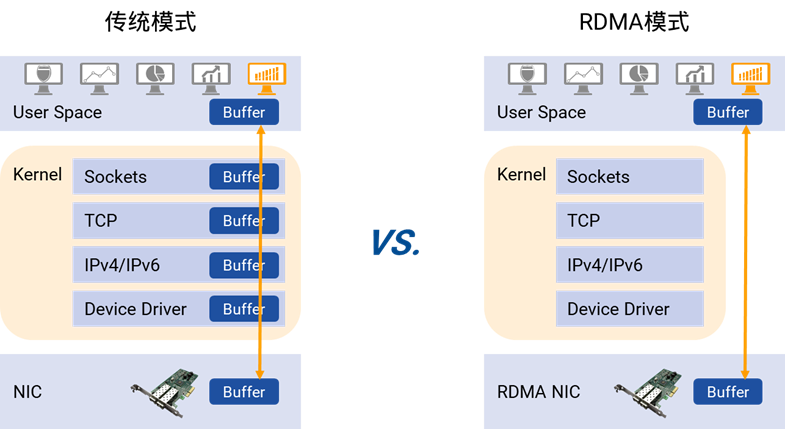
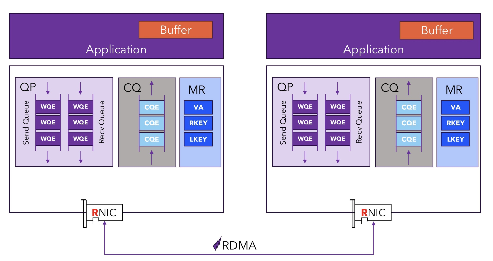
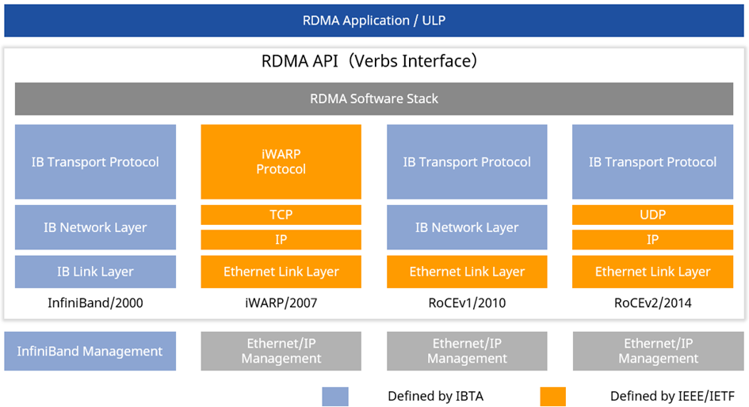

# 1. 概述

## 1.1. 基本原理



传统的 TCP/IP 传输流程为:

应用调用 `send` / `recv`，数据先进入内核 socket 缓冲，再经 TCP、IP 和网卡驱动处理，最后由网卡 DMA 发出。接收方向相反：网卡收包后由中断交给驱动，协议栈逐层解包，再拷回用户缓冲。CPU 要参与系统调用、校验、分片、拥塞控制和上下文切换。

这样会存在问题:

- **多次拷贝。** 发送至少有一次用户缓冲到内核的拷贝，接收再拷回用户缓冲。报文越大、连接越多，内存带宽和 CPU 占用越高。协议栈内部多半按指针传递 skb，并不是每一层都整包再拷一次，但用户态和内核之间这一来一回已经很贵。
- **协议栈开销。** TCP 状态机、校验和、重传和拥塞控制都在主机上完成。小包时，系统调用和软中断占的比例更明显。
- **CPU 成为瓶颈。** 搬运和协议处理占用的核，不能同时做业务计算。带宽上去之后，先打满的往往是 CPU，而不是链路。

对应 RDMA 则可跳过内核的包处理流程:

应用事先注册一块内存。发送时把工作请求交给网卡，网卡直接 DMA 读出这块用户缓冲并组包；对端网卡校验权限后，直接 DMA 写入已经注册好的内存。数据面不再经过 socket、TCP、IP 和驱动缓冲，如上图右侧。内核仍参与建连、注册内存和创建 QP，但不参与每次收发的拆包和拷贝。

从而带来优势:

- **零拷贝。** 载荷不进出内核缓冲，网卡和已注册的用户内存在 DMA 上直接对接。
- **内核旁路。** 传输层处理下沉到 RDMA 网卡，主机不再为每个包走协议栈。
- **CPU 卸载。** CPU 只负责投递请求和取完成事件。同样带宽下占用更低，时延也更短、更稳。


## 1.2. 工作流程



RDMA 是基于消息队列的点对点通信，每个应用都可以直接获取自己的消息，无需操作系统和协议栈的介入。基础的工作组件如下:

- **RNIC**：支持 RDMA 的网卡。在普通 MAC 收发之上，它能识别 RDMA 报文并解析协议头，再按队列里的描述符对已注册内存做 DMA 读或写，重传和确认也在网卡上完成。硬件方案的数据面不再把每个包交给内核

- **QP（Queue Pair）**：一条连接在本端的队列对，由 Send Queue 和 Recv Queue 组成。应用把要做的事写成 WQE 投进去：发送、RDMA WRITE / READ 进 SQ，准备接收 SEND 的缓冲进 RQ，然后敲门铃通知 RNIC 来取。对端有自己的 QP，报文用 QP 号对应到这条队列。RDMA WRITE / READ 只消耗发起方的 SQ，对端不必预先往 RQ 投递。

- **CQ（Completion Queue）**：完成队列。RNIC 做完一个 WQE 后写一条 CQE，说明成功或失败、操作类型和长度。应用通过轮询 CQ 来获知任务的完成状态。

- **MR（Memory Region）**：登记给 RNIC 的一块内存。`ibv_reg_mr` 钉住页面，并生成虚拟地址 VA、本地密钥 `lkey`、远程密钥 `rkey`。本端用 `lkey` 授权网卡 DMA 自己的缓冲；把 VA 和 `rkey` 交给对端后，对端才能对这块内存做 RDMA READ / WRITE。

以 demo 举例 (见附录1)，发送流程如下:

```c
	sge.addr = (uint64_t)(uintptr_t)ctx->buf;
	sge.length = (uint32_t)(msg_len + 1);
	sge.lkey = ctx->mr->lkey;

	wr.wr_id = 1;
	wr.opcode = IBV_WR_RDMA_WRITE;
	wr.send_flags = IBV_SEND_SIGNALED;
	wr.wr.rdma.remote_addr = remote.addr;
	wr.wr.rdma.rkey = remote.rkey;
	wr.sg_list = &sge;
	wr.num_sge = 1;

	if (ibv_post_send(id->qp, &wr, &bad_wr))
		die("ibv_post_send RDMA_WRITE");

	while (..) {
		if (ibv_poll_cq(ctx->cq, 1, &wc) == 1)
            if (wc.status == IBV_WC_SUCCESS)
			    return 0;
	}
```

应用需要将自身的写请求配置成一份 work request, 登记好 seg 并配置 opcode/addr/rkey 之后通过函数 `ibv_post_send` 登记内 rdma core 从而形成 QP 的 send queue, 提交给 RNIC。

随后用户需要通过函数 `ibv_poll_cq` 去检查 CQ 的结果从而确认发送状态.

与之对应的, server 一侧不需要做额外处理, 其只需要预先注册 MR 即可，数据会通过 rdma core 自动修改数据:

```c
	for (int i = 0; i < 5000 && !got_data; i++) {
		if (ctx->buf[0] != '\0')
			got_data = true;
		else
			usleep(1000);
	}

	if (!got_data) {
		fprintf(stderr, "[server] no data received\n");
		return 1;
	}

	printf("[server] received: \"%s\"\n", ctx->buf);
```


## 1.3. 协议栈

目前常用的 RDMA 协议有三种, 网络传输侧 RDMA 的实现方式主要分为 InfiniBand 和 Ethernet 两种。在以太网上，又可以根据与以太网融合的协议栈的差异分为 iWARP 和 RoCE (包括RoCEv1和RoCEv2)。



- IB (InfiniBand): 是由 IBTA 提出的原生 RDMA 协议，拥有自定义的 link layer，只允许专用的 IB NIC + switch 完成。
- iWARP (Internet Wide Area RDMA Protocol): 由多厂商联合城西 RDMA 联盟后另起炉灶构造的 RDMA over TCP/IP 协议。该协议可适配传统以太网交换机，同时利用已有的 TOE (TCP offload engine) 做拥塞控制，从而大大降低了 RDMA 的适配成本。但要求 NIC 支持 iWARP 协议并支持 TCP/IP offload。
- RoCE (RDMA over Converged Ethernet): 考虑到 IB 的适配成本问题，基于现有的以太网基础设施上适配 IB 协议的 RDMA 成为了一个重要课题。IBTA 为此陆续推出了两代 RoCE 协议标准
    - RoCEv1: IB over ethernet: 基于 802.3 协议填充以太网 header, 标记 Ethernet Type 为 0x8915, 以太网 header 以下采用 IB network layer 做传输.
    - RoCEv2: IB over UDP/IP: 进一步利用 IP 协议做转发以解决网络扩展性问题以支持多级组网.

# 2. 无损网络

RDMA 相较传统以太网而言解决了来自 CPU 和协议栈的瓶颈, 从而实现了低延迟、高吞吐与 CPU free。但是这导致其对丢包变得极其敏感。传统 TCP/IP 协议可通过 TCP 协议栈实现出错重传。而 RDMA 设计之初是基于 IB 网络，其采用的逐跳的、信用的控制方式很难产生丢包，因此在重传策略上，选择了简单高效的 go-back-N 的方式，即默认网络不会产生丢包，一旦接收乱序，便进行丢弃重传。这导致丢包的情况下整个链路的性能会存在显著退化，因此 RDMA 存在无损网络的需求。

无损网络处理的问题是丢包，丢包产生于拥塞。因此无损的核心的拥塞控制，要求整个网络在拥塞的情况下也避免丢包, 这对包括 RNIC 与 switch 在内的整个网络环境提出需求。

- **PFC（Priority-based Flow Control）**：链路层按优先级暂停，IEEE 802.1Qbb。交换机或网卡某个优先级的队列快满时，向上一跳发暂停帧，让对端先停发这一优先级；队列降下去后再发恢复。它只作用于相邻一跳，如果整个链路都存在拥塞，则 pause 帧会逐级传递，从而对整个链路降速。FPC 可在链路上发生拥塞时立刻暂停拥塞点的流量，从而避免了丢包。

- **DCQCN（Data Center Quantized Congestion Notification）**：PFC 可以应对瞬时流量脉冲导致的拥塞，但是在整个链路
RoCEv2 的端到端拥塞控制，跑在网卡上，不经过主机协议栈。交换机是拥塞点：出口队列超过阈值时，给报文的 IP 头打 ECN 标记，此时还不丢包。接收端网卡看到标记后，按流限速回一个 CNP。发送端网卡收到 CNP 就按比例降速；一段时间没有 CNP，再分阶段把速率加回去。这样拥塞在源头被收住，而不是只在上一跳被暂停。

PFC 负责队列将要溢出时不丢包，DCQCN 负责在那之前把发送速率降下来。只开 PFC，暂停会摊到别的流量上；只开 DCQCN，速率还没降下来时的突发仍然可能把缓存打满。无损优先级上两者一起用，PFC 是兜底，DCQCN 是常态的降速。

# 3. RDMA 通信库

# 参考文献:
- https://infrasys-ai.github.io/aiinfra-docs/02StorComm02NetworkComm/02RDMA.html
- https://zhuanlan.zhihu.com/p/657265815
- https://blog.csdn.net/bandaoyu/article/details/117560876
- https://support.huawei.com/enterprise/zh/doc/EDOC1100203347/860ce6cb
- https://asterfusion.com/blog20230808-rdma-evolution-process/
- https://www.cnblogs.com/bandaoyu/p/16752342.html#RDMA%E7%BC%96%E7%A8%8B%E5%9F%BA%E7%A1%80
- https://zhuanlan.zhihu.com/p/663891770
